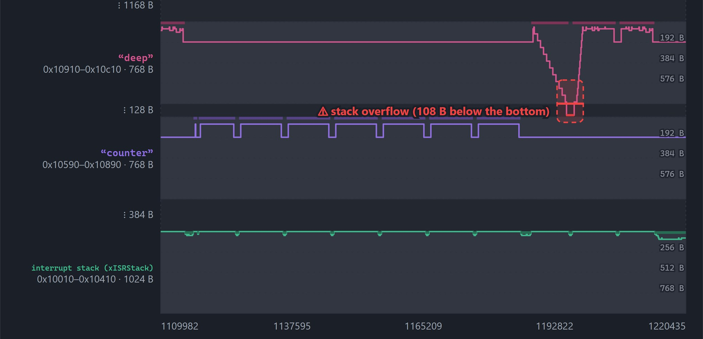
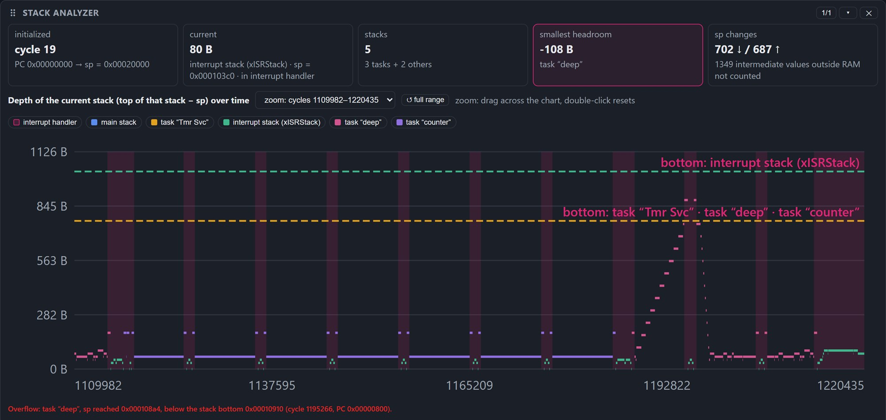
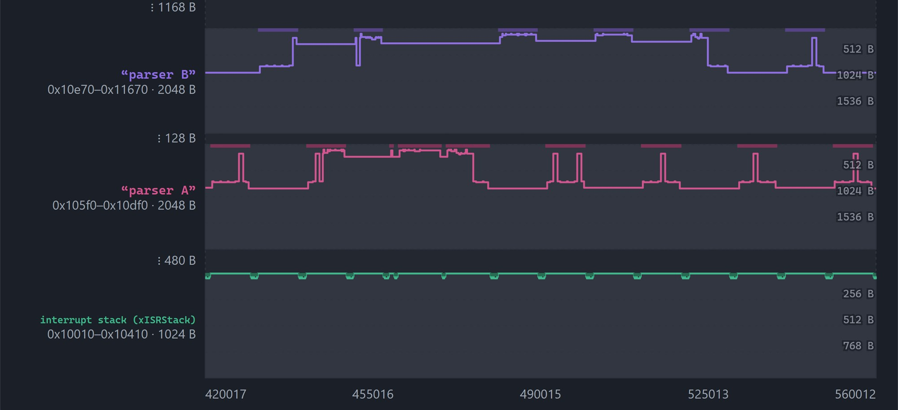
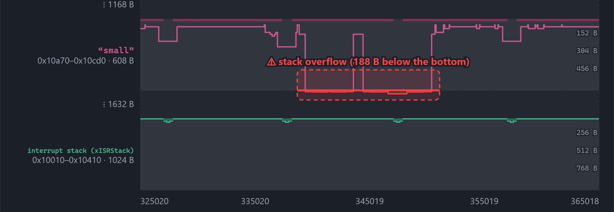
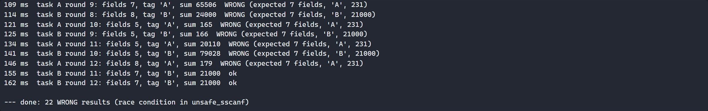

<p align="center">
  <picture>
    <source media="(prefers-color-scheme: dark)" srcset="docs/images/rvisio-logo-dark.svg">
    
  </picture>
</p>

<h3 align="center">Understand a RISC-V system by <i>visualizing</i> it.</h3>

<p align="center">
  Demo projects for <b>RVisio</b>, an educational platform for the embedded software and hardware of RISC-V based systems.<br>
  Real-time OS examples, bare-metal interrupt programs and a ready-to-use template, all running on the RVisio system on chip.
</p>

<p align="center">
  <a href="https://rvisio.com"><b>▶ Run the demos in your browser</b></a> ·
  <a href="#demo-projects">Demo projects</a> ·
  <a href="#build-and-debug-locally">Build &amp; debug</a> ·
  <a href="#your-own-application">Your own application</a>
</p>

<p align="center">
  
  
  
  
</p>

---

**RVisio** shows what a RISC-V system really does, cycle by cycle: the processor pipeline, caches, buses,
memories, peripherals, interrupts and the stack of every RTOS task. The processors are the original Verilog
(RTL) compiled to WebAssembly, so the simulator in your browser runs the same hardware that goes into an FPGA.

This repository holds the programs for the RVisio **system on chip (SoC)**: every project builds with
`make`, runs in the simulator and can be debugged from VS Code exactly like a program on a real
development board. The same programs are built into the simulator, so you can try them without installing anything.

<p align="center">
  <br>
  <sub><b>Stacks in memory</b> (from <code>freertos-stack-overflow</code>): the stack pointer of task “deep” steps down with every level of recursion and breaks through the bottom of its stack.</sub>
</p>

## Run a demo in 30 seconds

No toolchain, no board, no installation:

1. Open **[rvisio.com](https://rvisio.com)** and click **Open simulator**.
2. Choose the analysis **System on chip (SoC)**.
3. Click **📦 FreeRTOS demos**, pick a demo and press **▶ Run**.

RVisio loads the default SoC board and the compiled program, switches to the **Advanced** panel layout
(stack analyzer, stacks in memory, console) and starts the program. Use **⏭ To end** / **■ Stop**,
**+1 cycle** and **+1 instr.** to run, pause and step; drag across a chart to zoom in.

## Demo projects

| Project | What it shows | Watch in RVisio |
|---|---|---|
| [`freertos-stack-overflow`](demo/freertos-stack-overflow) | A task recurses one level deeper every 10 ms until it breaks through the bottom of its stack; the kernel detects it. `make OVERFLOW_CHECK=0` shows what happens without the check. | Stack analyzer, Stacks in memory (red overflow zone), Console |
| [`freertos-sscanf`](demo/freertos-sscanf) | A non-thread-safe `sscanf()`: a **race** between two tasks (`make DEMO=race`), the reentrant **fix** (`safe`), a **stack overflow** caught by the kernel (`stack`) and a **silent crash** the kernel misses (`crash`). | Console (`WRONG` results), Stacks in memory |
| [`freertos-demo`](demo/freertos-demo) | Producer and consumer: a button interrupt wakes the producer, a queue carries the message, the consumer prints it. | Peripherals → gpio0 (click a button), Console |
| [`soc-demo`](demo/soc-demo) | Bare metal, no OS: timer and UART interrupts through the interrupt controller interrupt the main loop. | Peripheral events and interrupts, Processor (mepc, mcause) |
| [`freertos-template`](demo/freertos-template) | The starting point for your own FreeRTOS application: kernel, SoC port, settings and one example task. | |
| [`baremetal-template`](demo/baremetal-template) | The smallest C project without an OS: startup code, linker script, `soc.h` and a `main.c` that prints over the UART. | Console, Peripherals → gpio0 |

<table>
  <tr>
    <td width="50%"><br><sub><b>Stack analyzer</b>: depth of every stack over time, with each stack's bottom (dashed).</sub></td>
    <td width="50%"><br><sub><b>sscanf race</b>: “parser A” and “parser B” take turns in the middle of a call (dark bar = running task).</sub></td>
  </tr>
  <tr>
    <td><br><sub><b>Silent crash</b>: task “small” goes below its stack bottom while the kernel check stays silent.</sub></td>
    <td><br><sub><b>Console (UART)</b>: 22 of 24 results are wrong because of the race.</sub></td>
  </tr>
</table>

## Build and debug locally

### 0. Get the code

```bash
git clone https://github.com/Department-Of-Electronics/rvisio.git
cd rvisio/demo
```

In RVisio the same link is in the SoC analysis: **⎇ Examples on GitHub** (toolbar *Debug (VS Code / GDB)*)
and in **📦 FreeRTOS demos**.

### 1. Toolchain

**Which route on Windows?** Both need Windows 10 or 11 (64-bit), because VS Code and current Python do.

| | Windows + WSL | Windows without WSL (xPack) |
|---|---|---|
| Windows version | Windows 10 version 2004 or later, or Windows 11 (64-bit) | Windows 10 or 11 (64-bit) |
| Home edition | works | works |
| Administrator rights | needed to install WSL | not needed (the tools are just unpacked) |
| Virtualization in the BIOS | must be on | not needed |
| Inside a virtual machine | often does not work (needs nested virtualization) | works |
| Disk space | about 1–2 GB (Ubuntu and the tools) | about 300–500 MB |
| Projects in this repository | all | for now only [`baremetal-template`](demo/baremetal-template) |

WSL is the recommended route: one script installs everything and the tools are the same as on Linux.
xPack is the better choice for lab computers without administrator rights, locked work laptops, computers
with virtualization turned off and Windows in a virtual machine. Step by step instructions for both are in
RVisio: SoC → **📘 VS Code guide**.

Linux or Windows with WSL (Ubuntu):

```bash
sudo apt install make gcc-riscv64-unknown-elf gdb-multiarch
```

The projects are built for RV32IM (`-march=rv32im_zicsr -mabi=ilp32`) without a C library; the 64-bit
`riscv64-unknown-elf-gcc` builds 32-bit code with these flags.

### 2. Build

```bash
cd demo/freertos-stack-overflow
make                      # build/app.elf, build/app.lst (disassembly), build/app.map
```

`freertos-sscanf` has several programs: `make DEMO=race|safe|stack|crash`.

### 3. Run your build in RVisio

Simulator → **System on chip (SoC)** → **📂 ELF** → choose `build/app.elf` → **⏭ To end**.
Output appears in the **Console** panel (UART0); buttons and LEDs are in **Peripherals → gpio0**.

> Guests (no account) can run the built-in demos; loading your own ELF needs a free account
> (**Register** on the sign-in page).

### 4. Debug from VS Code

RVisio works as a GDB server, like a development board attached to your computer.

1. Install VS Code with the **C/C++** extension (`ms-vscode.cpptools`); on Windows also WSL and the
   **WSL** extension.
2. Open **exactly the project folder** (the one with the `Makefile` and `.vscode/`, for example
   `demo/freertos-demo`) in VS Code: File → Open Folder. Not the whole repository, not `src` and not just
   `main.c`, otherwise VS Code does not see the debug configuration.
3. In RVisio (SoC) click **🐞 GDB server**. When the simulator runs on another computer, it shows a short
   code; start the bridge script (it is in `tools/` at the root of the repository) with it from the
   project folder and leave it running:

   ```bash
   python3 ../../tools/rvsim-gdb.py <code>          # Linux
   wsl python3 ../../tools/rvsim-gdb.py <code>      # Windows with WSL (PowerShell)
   py ..\..\tools\rvsim-gdb.py <code>               # Windows without WSL (xPack)
   ```

   On Windows with WSL start the bridge **with `wsl` in front**: GDB runs in WSL and looks for the bridge on
   `127.0.0.1:3333` inside WSL. The bridge talks to `https://rvisio.com` by default; for a simulator at
   another address add `--server`, for example `--server http://localhost:8000`.
4. Press **F5** in VS Code: the project is built (`make`), GDB connects, erases the memories, loads the
   program and stops at `main`. Breakpoints, stepping and variables work as usual, also in assembly
   (`startup.S`, the port).
5. While you step, the browser shows the same moment in hardware: the **Program** panel lists the code GDB
   loaded with the current instruction highlighted, and the processor, stack and peripheral panels follow.

The `.vscode/` configurations have no absolute paths: on Windows GDB runs in WSL (default distribution) and
paths are mapped automatically (`/mnt/c/...` ↔ `C:/...`); on Linux, or for a folder opened in WSL, the
same `launch.json` uses `gdb-multiarch` directly.

### Troubleshooting

| Symptom | Cause and fix |
|---|---|
| F5 runs `main.c` as a Windows program, asks for a compiler (`cl.exe`, `gcc`) or offers to create `launch.json` | The project folder is not open. File → Open Folder → for example `demo/freertos-demo`, then choose the SoC configuration in Run and Debug. |
| The bridge says it is connected, but F5 cannot connect (connection refused or timeout) | Windows with WSL: the bridge was started with Windows Python. Stop it and start it with `wsl python3 ../../tools/rvsim-gdb.py <code>`. |
| `can't open file … rvsim-gdb.py` | The bridge is in `tools/` at the root of the repository: `../../tools/rvsim-gdb.py` from a project folder. |
| Bridge: unknown code, although the code is correct | The bridge and the browser page use different servers: add `--server <address of the page>`. |
| Connection refused / `monitor` command not supported | Turn on **🐞 GDB server** in RVisio; if the simulator is on a server, start the bridge. |
| Remote connection closed | The tab with the SoC was closed or reloaded: open the SoC, click **🐞 GDB server**, press F5 again. |
| WSL: “Please enable the Virtual Machine Platform” / `0x80370102` | Virtualization is off in the BIOS or Windows runs in a virtual machine: turn on Intel VT-x / AMD-V, or use the xPack route. |

More cases are in RVisio: SoC → **📘 VS Code guide** → Troubleshooting.

## Your own application

With an RTOS: copy [`demo/freertos-template`](demo/freertos-template), write your tasks in `src/main.c` and add
new `.c` files to `SRCS` in the `Makefile`. Without an OS: copy [`demo/baremetal-template`](demo/baremetal-template). The register addresses are in `src/soc.h`; the full description of the
board (memory map, interrupts, every peripheral register with its bits and a C example) is generated by the
simulator: SoC → **📄 Datasheet** (print it to PDF with **🖨 Save as PDF**).

## The RVisio SoC (default board)

| Region | Address | Notes |
|---|---|---|
| Flash | `0x0000_0000`, 64 KB | code (`.text`, `.rodata`) |
| SRAM | `0x0001_0000`, 64 KB | `.data`, `.bss`, heap, stacks |
| UART0 | `0x0080_0000` | console in RVisio (TX/RX, interrupt 0) |
| GPIO | `0x0080_3000` | buttons and LEDs (interrupt 3) |
| TIMER0 | `0x0080_4000` | RTOS tick (interrupt 4) |
| INTC | `0x0080_5000` | interrupt controller; SOFT = software interrupt 31 (task switch) |

Supported cores for an RTOS: FemtoRV32 Intermissum-FDE, AONR-V (multi-cycle, 5-stage pipeline with and
without forwarding) and VeeR EH2. Details of the port are in [`demo/freertos-demo/README.md`](demo/freertos-demo).

> **RTOS support:** for now RVisio supports FreeRTOS (V11.3.1); support for other real-time and operating
> systems is coming.

## Repository layout

```
demo/
  freertos-stack-overflow/   stack overflow, with and without the kernel check
  freertos-sscanf/           non-thread-safe sscanf(): race, fix, stack overflow, silent crash
  freertos-demo/             producer and consumer (button → queue → console)
  soc-demo/                  bare-metal interrupts (timer + UART), no OS
  freertos-template/         starting point for your own FreeRTOS application
  baremetal-template/        starting point for a program without an OS
tools/
  rvsim-gdb.py               GDB bridge: VS Code on your computer <-> RVisio in the browser (rvisio.com)
doc/                         note about the datasheet (generated by the simulator)
docs/images/                 logo and screenshots used in this README
```

Every FreeRTOS project contains its own copy of the kernel files it needs (`FreeRTOS-Kernel/`), so a
project folder can be copied and built on its own.

## Credits

RVisio is developed at the **School of Electrical Engineering, University of Belgrade**
(Department of Electronics).

* [FreeRTOS-Kernel](https://github.com/FreeRTOS/FreeRTOS-Kernel) V11.3.1, MIT license (see `FreeRTOS-Kernel/LICENSE.md` in each project).
* Processors in RVisio: [FemtoRV32](https://github.com/BrunoLevy/learn-fpga) (Bruno Levy),
  AONR-V (developed for RVisio) and [VeeR EH2](https://github.com/chipsalliance/Cores-VeeR-EH2) (CHIPS Alliance).
